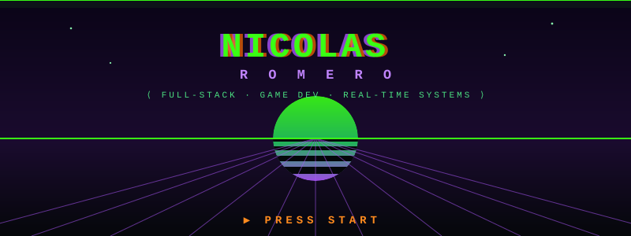

  

  
  
  
  

---

# Hi, I'm Nicolas Romero 👋
### Full-Stack & Game Developer 🎮

I build **high-concurrency, real-time and transactional systems** — from backend engines and distributed services to interactive worlds and AI automation. Polyglot by nature, I pick the right tool for the job and care about performance where it counts.

- ⚡ **Systems:** High-concurrency, real-time and transactional architectures.
- 🎮 **Game Dev:** Interactive, physics-driven experiences in Unreal Engine & Unity.
- 🤖 **AI Automation:** LLM-powered pipelines and workflow automation.

  

---

### 🛠️ Technical Arsenal

  
  
  
  
  
  
  
  
  
  
  

| Category | Technologies |
| :--- | :--- |
| **Languages** | C++, Rust, Go, Ruby, TypeScript, JavaScript |
| **Game Engines** | Unreal Engine, Unity |
| **Backend** | Ruby on Rails, Go, high-concurrency services, REST / real-time APIs |
| **Frontend** | React, Vue, TypeScript |
| **Systems** | High-Concurrency, Real-Time, Transactional |
| **DevOps** | Docker, Kubernetes, CI/CD |
| **AI** | LLMs, AI Automation |

---

### 🚀 Focus Areas

<b>⚡ Real-Time & High-Concurrency Systems</b>

 
Designing backends that stay fast and consistent under heavy concurrent load — event-driven services, real-time data flows and careful resource management.

<b>💳 Transactional Systems</b>

 
Building systems where correctness and integrity matter: consistent state, safe concurrency and reliable transactional guarantees.

<b>🎮 Game Development</b>

 
Interactive experiences and gameplay systems in Unreal Engine (C++) and Unity (C#), with real-time logic, physics and optimized rendering.

<b>🤖 AI Automation</b>

 
LLM-powered automation and tooling — turning repetitive workflows into intelligent, self-running pipelines.

---

### 🌌 Command Center

  

---

### 📊 Activity

  

  

